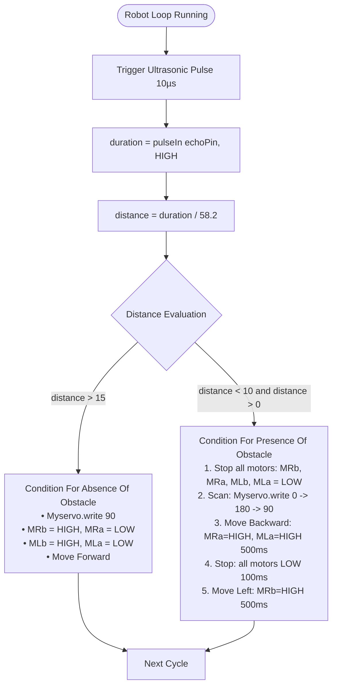

# Obstacle Avoidance Robot

**Teachers Readiness Programme on Robotics and AI — June 2024**  
*Technology Innovation Hub of IIT Delhi (IHFC) & Council for the Indian School Certificate Examinations (CISCE)*  

- **Instructors:**  
  - Dr. Venkat Bokka, IHFC ([venkat@ihfc.co.in](mailto:venkat@ihfc.co.in))  
  - Ms. Mrinmoyee Choudhuri, IHFC ([mrinmoyee@ihfc.co.in](mailto:mrinmoyee@ihfc.co.in))  
- **Source Code Sketch:** [`Obstacle Avoidance Robot.ino`](./Obstacle%20Avoidance%20Robot.ino)  
- **Circuit Diagram:** [`Wiring.png`](./Wiring.png)  

---

## Table of Contents
1. [Objective](#1-objective)
2. [Materials Required](#2-materials-required)
3. [Procedure](#3-procedure)
   - [3.1 Connecting the Ultrasonic Sensor Module](#31-connecting-the-ultrasonic-sensor-module)
   - [3.2 Connecting the Servo Motor](#32-connecting-the-servo-motor)
   - [3.3 Assemble the Robot Chassis](#33-assemble-the-robot-chassis)
   - [3.4 Connect the Motor Driver Module](#34-connect-the-motor-driver-module)
   - [3.5 Program the Arduino](#35-program-the-arduino)
4. [Circuit Assembly & Wiring Diagram](#4-circuit-assembly--wiring-diagram)
5. [Algorithm & Navigation Logic](#5-algorithm--navigation-logic)
6. [Arduino Code](#6-arduino-code)
7. [Conclusion](#7-conclusion)

---

## 1. Objective

The objective of this project is to build an obstacle-avoiding robot using an Arduino microcontroller, ultrasonic sensor, and servo motor. This project aims to demonstrate the principles of autonomous navigation by detecting obstacles in the robot's path and adjusting its course accordingly.

---

## 2. Materials Required

| # | Component | Description |
|---|---|---|
| 1 | **Arduino Uno R3** | The microcontroller that will process the sensor data. |
| 2 | **Ultrasonic Sensor Module (HC-SR04)** | Used to measure the distance of objects. |
| 3 | **Servo Motor (SG90 / Standard)** | The actuator that will be controlled for precise angular movements. |
| 4 | **Motor Driver Module (L298N)** | Controls the speed and direction of the DC motors, providing sufficient power and control. |
| 5 | **DC Motors with Wheels (2 or 4)** | Convert electrical energy into mechanical movement to drive the robot's wheels. |
| 6 | **Robot Chassis** | The frame that holds all components together, providing structure and support. |
| 7 | **Breadboard** | A prototyping board that allows easy connection of components without soldering. |
| 8 | **Battery Pack** | Provides power to the robot, ensuring all components receive the necessary voltage and current. |
| 9 | **Jumper Wires** | Used to make connections between components, Female to Male and Male to Male jumpers are require. |

---

## 3. Procedure

### 3.1 Connecting the Ultrasonic Sensor Module
- **VCC Pin:** Connect the VCC pin of the ultrasonic sensor to the 5V pin on the Arduino. This provides the necessary power to the ultrasonic sensor.
- **GND Pin:** Connect the GND pin of the ultrasonic sensor to the GND pin on the Arduino. This completes the electrical circuit.
- **TRIG Pin:** Connect the TRIG pin of the ultrasonic sensor to a digital pin (e.g., pin 9) on the Arduino. This pin is used to trigger the ultrasonic pulse.
- **ECHO Pin:** Connect the ECHO pin of the ultrasonic sensor to another digital pin (e.g., pin 8) on the Arduino. This pin will receive the echo signal and measure the time taken for the pulse to return.

### 3.2 Connecting the Servo Motor
- **Power (Vcc):** Connects to the power supply (usually 5V). *(Color: Red)*
- **Ground (Gnd):** Connects to the ground of the Arduino. *(Color: Black/Brown)*
- **Signal:** Connects to a PWM-capable digital pin on the Arduino (pin 10). *(Color: Yellow/Orange)*

### 3.3 Assemble the Robot Chassis
- Attach the DC motors to the chassis.
- Mount the wheels onto the motors.
- Secure the battery pack and motor driver module to the chassis.

### 3.4 Connect the Motor Driver Module
- Connect the IN1 and IN2 pins of the motor driver to digital pins 7 and 6 on the Arduino respectively (for the first motor).
- Connect the IN3 and IN4 pins of the motor driver to digital pins 5 and 4 on the Arduino respectively (for the second motor).
- *(Optional)* Connect the ENA pin to digital pin 5 (for speed control of the first motor) and ENB pin to digital pin 3 (for speed control of the second motor).
- Connect the motor power supply to the motor driver module.
- Connect the 5v of motor power supply to the Vin of the Arduino to power the module.

### 3.5 Program the Arduino
- Download and install the Arduino IDE from the official Arduino website.
- Connect your Arduino Uno R3 to your computer using a USB cable.
- Open the Arduino IDE and select the correct board and port by navigating to `Tools > Board > Arduino Uno` and `Tools > Port > (Select your Arduino's port)`.
- Open a new sketch by navigating to `File > New`.
- Write the code into the Arduino IDE:
- Click the Verify button / $\checkmark$ icon to compile the code and check for errors.
- Once the code compiles successfully, click the Upload button (right arrow icon) to upload the code to the Arduino board.

---

## 4. Circuit Assembly & Wiring Diagram

The complete circuit connects the Arduino Uno R3, HC-SR04 ultrasonic sensor, servo motor, L298N motor driver, geared motors, and battery.

[](./Wiring.png)

> **Direct Link:** [Open `Wiring.png` in full resolution](./Wiring.png)

### Pin Connection Summary

| Subsystem | Component Pin | Arduino Uno Pin | Wire Color / Function |
|---|---|---|---|
| **Ultrasonic Sensor (HC-SR04)** | VCC | 5V | Red |
| | GND | GND | Black |
| | TRIG | Digital Pin 9 | Yellow / Green |
| | ECHO | Digital Pin 8 | Blue / White |
| **Servo Motor** | Power (Vcc) | 5V | Red |
| | Ground (Gnd) | GND | Black / Brown |
| | Signal | Digital Pin 10 | Yellow / Orange (PWM) |
| **L298N Motor Driver** | IN1 | Digital Pin 7 | First / Right Motor (`MRb`) |
| | IN2 | Digital Pin 6 | First / Right Motor (`MRa`) |
| | IN3 | Digital Pin 5 | Second / Left Motor (`MLb`) |
| | IN4 | Digital Pin 4 | Second / Left Motor (`MLa`) |
| | 5V Out | Vin | Powers Arduino board |
| | GND | GND | Common Ground |
| **Battery Pack** | Positive (+) | L298N +12V Terminal | Motor driver power |
| | Negative (-) | L298N GND Terminal | Common Ground |

---

## 5. Algorithm & Navigation Logic



---

## 6. Arduino Code

The standalone sketch file is available at [`Obstacle Avoidance Robot.ino`](./Obstacle%20Avoidance%20Robot.ino).

```cpp
#include <Servo.h>

Servo Myservo;

#define trigPin 9       // Trig Pin Of HC-SR04
#define echoPin 8       // Echo Pin Of HC-SR04
#define MLa 4           // Left motor 1st pin
#define MLb 5           // Left motor 2nd pin
#define MRa 6           // Right motor 1st pin
#define MRb 7           // Right motor 2nd pin

long duration, distance;

void setup() {
    Serial.begin(9600);

    pinMode(MLa, OUTPUT);
    pinMode(MLb, OUTPUT);
    pinMode(MRa, OUTPUT);
    pinMode(MRb, OUTPUT);

    pinMode(trigPin, OUTPUT);
    pinMode(echoPin, INPUT);

    Myservo.attach(10);
}

void loop()
{
    Serial.begin(9600);

    digitalWrite(trigPin, LOW);
    delayMicroseconds(2);

    digitalWrite(trigPin, HIGH);   // Transmit Waves For 10us
    delayMicroseconds(10);

    duration = pulseIn(echoPin, HIGH);  // Receive Reflected Waves
    distance = duration / 58.2;         // Get Distance

    Serial.println(distance);
    delay(10);

    if (distance > 15)   // Condition For Absence Of Obstacle
    {
        Myservo.write(90);

        digitalWrite(MRb, HIGH);   // Move Forward
        digitalWrite(MRa, LOW);
        digitalWrite(MLb, HIGH);
        digitalWrite(MLa, LOW);
    }

    else if ((distance < 10) && (distance > 0))
    {
        digitalWrite(MRb, LOW);    // Stop
        digitalWrite(MRa, LOW);
        digitalWrite(MLb, LOW);
        digitalWrite(MLa, LOW);

        delay(100);

        Myservo.write(0);
        delay(500);

        Myservo.write(180);
        delay(500);

        Myservo.write(90);
        delay(500);

        digitalWrite(MRb, LOW);    // Move Backward
        digitalWrite(MRa, HIGH);
        digitalWrite(MLb, LOW);
        digitalWrite(MLa, HIGH);

        delay(500);

        digitalWrite(MRb, LOW);    // Stop
        digitalWrite(MRa, LOW);
        digitalWrite(MLb, LOW);
        digitalWrite(MLa, LOW);

        delay(100);

        digitalWrite(MRb, HIGH);   // Move Left
        digitalWrite(MRa, LOW);
        digitalWrite(MLa, LOW);
        digitalWrite(MLb, LOW);

        delay(500);
    }
}
```

---

## 7. Conclusion

This project illustrates the construction of an obstacle-avoidance robot utilizing an arduino microcontroller, ultrasonic sensor, and servo motor. Participants acquire hands-on experience in autonomous navigation and robotics, learning to effectively integrate and program diverse components to operate harmoniously.
