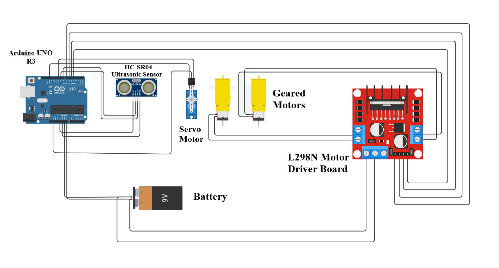
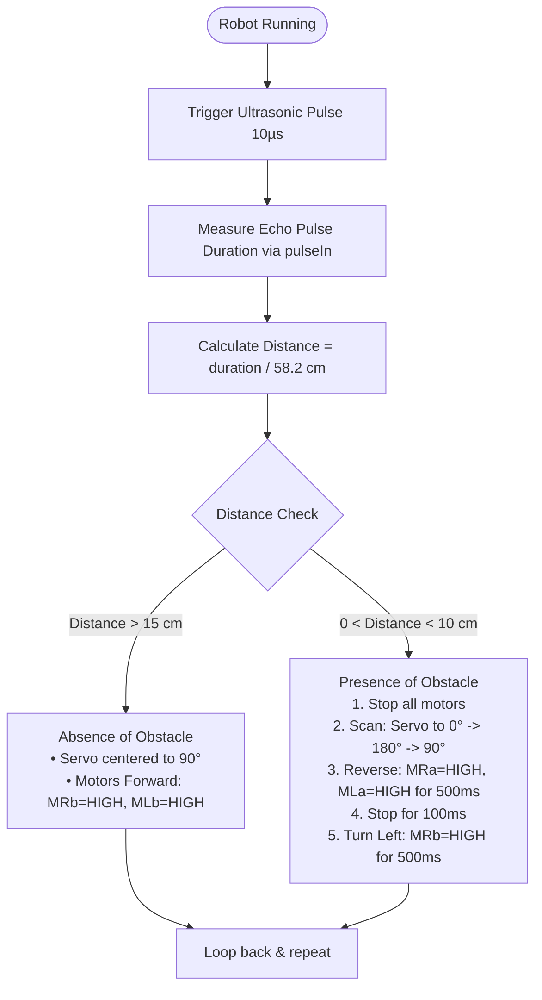

# Obstacle Avoidance Robot

**Teachers Readiness Programme on Robotics and AI — June 2024**  
*Technology Innovation Hub of IIT Delhi (IHFC) & Council for the Indian School Certificate Examinations (CISCE)*  

- **Instructors:**  
  - Dr. Venkat Bokka, IHFC ([venkat@ihfc.co.in](mailto:venkat@ihfc.co.in))  
  - Ms. Mrinmoyee Choudhuri, IHFC ([mrinmoyee@ihfc.co.in](mailto:mrinmoyee@ihfc.co.in))  
- **Source Code Sketch:** [`Obstacle Avoidance Robot.ino`](./Obstacle%20Avoidance%20Robot.ino)  
- **Circuit Diagram:** [`Wiring.png`](./Wiring.png)  

---

## Table of Contents
1. [Objective](#1-objective)
2. [Materials Required](#2-materials-required)
3. [Procedure](#3-procedure)
   - [3.1 Connecting the Ultrasonic Sensor Module](#31-connecting-the-ultrasonic-sensor-module)
   - [3.2 Connecting the Servo Motor](#32-connecting-the-servo-motor)
   - [3.3 Assemble the Robot Chassis](#33-assemble-the-robot-chassis)
   - [3.4 Connect the Motor Driver Module](#34-connect-the-motor-driver-module)
   - [3.5 Program the Arduino](#35-program-the-arduino)
4. [Circuit Assembly & Wiring Diagram](#4-circuit-assembly--wiring-diagram)
5. [Algorithm & Navigation Logic](#5-algorithm--navigation-logic)
6. [Arduino Code](#6-arduino-code)
7. [Conclusion](#7-conclusion)

---

## 1. Objective

The objective of this project is to build an obstacle-avoiding robot using an Arduino microcontroller, ultrasonic sensor, and servo motor. This project aims to demonstrate the principles of autonomous navigation by detecting obstacles in the robot's path and adjusting its course accordingly.

---

## 2. Materials Required

| # | Component | Description |
|---|---|---|
| 1 | **Arduino Uno R3** | The microcontroller that processes the sensor data and runs navigation decisions. |
| 2 | **Ultrasonic Sensor Module (HC-SR04)** | Used to measure the distance of objects in front of the robot. |
| 3 | **Servo Motor (SG90 / Standard)** | The actuator that is controlled for precise angular scanning movements ($0^\circ - 180^\circ$). |
| 4 | **Motor Driver Module (L298N)** | Controls the speed and direction of the DC motors, providing sufficient power and current isolation. |
| 5 | **DC Motors with Wheels (2 or 4)** | Converts electrical energy into mechanical movement to drive the robot's wheels. |
| 6 | **Robot Chassis** | The physical frame that holds all components together, providing structure and support. |
| 7 | **Breadboard** | A prototyping board that allows easy connection of components without soldering. |
| 8 | **Battery Pack (e.g. 9V / 2×18650)** | Provides power to the robot, ensuring all components receive the necessary voltage and current. |
| 9 | **Jumper Wires** | Used to make connections between components (Female-to-Male and Male-to-Male jumpers required). |

---

## 3. Procedure

### 3.1 Connecting the Ultrasonic Sensor Module
- **VCC Pin:** Connect the VCC pin of the ultrasonic sensor to the **5V** pin on the Arduino. This provides the necessary power to the ultrasonic sensor.
- **GND Pin:** Connect the GND pin of the ultrasonic sensor to the **GND** pin on the Arduino. This completes the electrical circuit.
- **TRIG Pin:** Connect the TRIG pin of the ultrasonic sensor to a digital pin (**Digital Pin 9**) on the Arduino. This pin is used to trigger the ultrasonic pulse.
- **ECHO Pin:** Connect the ECHO pin of the ultrasonic sensor to another digital pin (**Digital Pin 8**) on the Arduino. This pin will receive the echo signal and measure the time taken for the pulse to return.

### 3.2 Connecting the Servo Motor
- **Power ($V_{CC}$):** Connects to the power supply (usually **5V**). *(Wire Color: Red)*
- **Ground (GND):** Connects to the ground of the Arduino (**GND**). *(Wire Color: Black / Brown)*
- **Signal:** Connects to a PWM-capable digital pin on the Arduino (**Digital Pin 10**). *(Wire Color: Yellow / Orange)*

### 3.3 Assemble the Robot Chassis
- Attach the DC motors securely to the chassis.
- Mount the wheels onto the motor shafts.
- Secure the battery pack and motor driver module to the chassis.

### 3.4 Connect the Motor Driver Module (L298N)
- Connect the **IN1** and **IN2** pins of the motor driver to **Digital Pins 7 and 6** on the Arduino respectively (for the first / right motor).
- Connect the **IN3** and **IN4** pins of the motor driver to **Digital Pins 5 and 4** on the Arduino respectively (for the second / left motor).
- *(Optional)* Connect the **ENA** pin to Digital Pin 5 (for speed control of the first motor) and **ENB** pin to Digital Pin 3 (for speed control of the second motor).
- Connect the motor power supply to the motor driver module terminal block.
- Connect the **5V** output of the motor power supply regulator to the **Vin** of the Arduino to power the board.

### 3.5 Program the Arduino
1. Download and install the Arduino IDE from the official [Arduino Website](https://www.arduino.cc/en/software).
2. Connect your Arduino Uno R3 to your computer using a USB cable.
3. Open the Arduino IDE and select the correct board and port by navigating to:
   - `Tools > Board > Arduino AVR Boards > Arduino Uno`
   - `Tools > Port >` *(Select your Arduino's active COM port)*
4. Open a new sketch by navigating to `File > New`.
5. Write or paste the code into the Arduino IDE editor.
6. Click the **Verify** button ($\checkmark$ icon) to compile the code and check for errors.
7. Once the code compiles successfully, click the **Upload** button ($\rightarrow$ icon) to upload the code to the Arduino board.

---

## 4. Circuit Assembly & Wiring Diagram

The complete circuit interconnects the Arduino Uno R3, HC-SR04 ultrasonic sensor, SG90 servo motor, L298N motor driver, geared DC motors, and battery pack.

[](./Wiring.png)

> **Image Link:** Click [here to open `Wiring.png`](./Wiring.png) directly in full resolution.

### Complete Pin Interconnection Summary

| Subsystem | Component Pin | Arduino Uno Pin | Wire Color / Notes |
|---|---|---|---|
| **Ultrasonic Sensor (HC-SR04)** | VCC | 5V | Red |
| | GND | GND | Black |
| | TRIG | Digital Pin 9 | Yellow / Green |
| | ECHO | Digital Pin 8 | Blue / White |
| **Servo Motor** | VCC | 5V | Red |
| | GND | GND | Black / Brown |
| | Signal (PWM) | Digital Pin 10 | Yellow / Orange |
| **L298N Motor Driver** | IN1 (MRb) | Digital Pin 7 | Controls Right Motor direction |
| | IN2 (MRa) | Digital Pin 6 | Controls Right Motor direction |
| | IN3 (MLb) | Digital Pin 5 | Controls Left Motor direction |
| | IN4 (MLa) | Digital Pin 4 | Controls Left Motor direction |
| | 5V Out | Vin | Powers Arduino board |
| | GND | GND | Common ground reference |
| **Power Supply** | Battery (+) | L298N +12V Terminal | Motor driver power input |
| | Battery (-) | L298N GND Terminal | Shared Ground |

---

## 5. Algorithm & Navigation Logic

The robot continuously measures the distance to any object in its forward path using ultrasonic echo timing. The decision logic operates as follows:



1. **Clear Path ($\text{Distance} > 15\,\text{cm}$):**
   - The servo centers at $90^\circ$.
   - Right motor and Left motor drive forward (`MRb = HIGH`, `MLb = HIGH`).
2. **Obstacle Detected ($0 < \text{Distance} < 10\,\text{cm}$):**
   - **Stop:** All motor pins set to `LOW` for $100\,\text{ms}$.
   - **Look Around:** Servo scans right ($0^\circ$), left ($180^\circ$), and re-centers ($90^\circ$) with $500\,\text{ms}$ delays.
   - **Reverse:** Motors drive in reverse (`MRa = HIGH`, `MLa = HIGH`) for $500\,\text{ms}$.
   - **Stop:** Motors pause for $100\,\text{ms}$.
   - **Turn:** Robot turns left (`MRb = HIGH`) for $500\,\text{ms}$ before resuming normal navigation.

---

## 6. Arduino Code

The standalone sketch file is available at [`Obstacle Avoidance Robot.ino`](./Obstacle%20Avoidance%20Robot.ino).

```cpp
#include <Servo.h>
Servo Myservo;
#define trigPin 9       // Trig Pin Of HC-SR04
#define echoPin 8       // Echo Pin Of HC-SR04
#define MLa 4           // left motor 1st pin
#define MLb 5           // left motor 2nd pin
#define MRa 6           // right motor 1st pin
#define MRb 7           // right motor 2nd pin

long duration, distance;

void setup() {
  Serial.begin(9600);
  pinMode(MLa, OUTPUT);        // Set Motor Pins As O/P
  pinMode(MLb, OUTPUT);
  pinMode(MRa, OUTPUT);
  pinMode(MRb, OUTPUT);
  pinMode(trigPin, OUTPUT);    // Set Trig Pin As O/P To Transmit Waves
  pinMode(echoPin, INPUT);     // Set Echo Pin As I/P To Receive Reflected Waves
  Myservo.attach(10);
}

void loop()
{
  Serial.begin(9600);
  digitalWrite(trigPin, LOW);
  delayMicroseconds(2);
  digitalWrite(trigPin, HIGH);        // Transmit Waves For 10us
  delayMicroseconds(10);
  duration = pulseIn(echoPin, HIGH);  // Receive Reflected Waves
  distance = duration / 58.2;         // Get Distance
  Serial.println(distance);
  delay(10);
  if (distance > 15)                  // Condition For Absence Of Obstacle
  {
    Myservo.write(90);
    digitalWrite(MRb, HIGH);          // Move Forward
    digitalWrite(MRa, LOW);
    digitalWrite(MLb, HIGH);
    digitalWrite(MLa, LOW);
  }
  else if ((distance < 10) && (distance > 0))  // Condition For Presence Of Obstacle
  {
    digitalWrite(MRb, LOW);           // Stop
    digitalWrite(MRa, LOW);
    digitalWrite(MLb, LOW);
    digitalWrite(MLa, LOW);
    delay(100);

    Myservo.write(0);
    delay(500);
    Myservo.write(180);
    delay(500);
    Myservo.write(90);
    delay(500);

    digitalWrite(MRb, LOW);           // Move Backward
    digitalWrite(MRa, HIGH);
    digitalWrite(MLb, LOW);
    digitalWrite(MLa, HIGH);
    delay(500);
    digitalWrite(MRb, LOW);           // Stop
    digitalWrite(MRa, LOW);
    digitalWrite(MLb, LOW);
    digitalWrite(MLa, LOW);
    delay(100);
    digitalWrite(MRb, HIGH);          // Move Left
    digitalWrite(MRa, LOW);
    digitalWrite(MLa, LOW);
    digitalWrite(MLb, LOW);
    delay(500);
  }
}
```

---

## 7. Conclusion

This project illustrates the construction of an obstacle-avoidance robot utilizing an Arduino microcontroller, ultrasonic sensor, and servo motor. Participants acquire hands-on experience in autonomous navigation and robotics, learning to effectively integrate and program diverse components to operate harmoniously.
