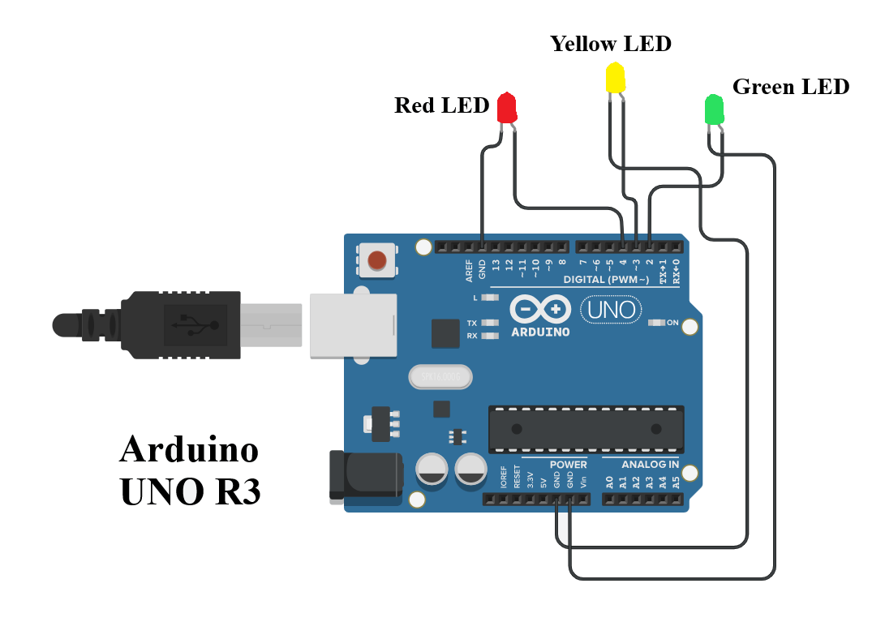
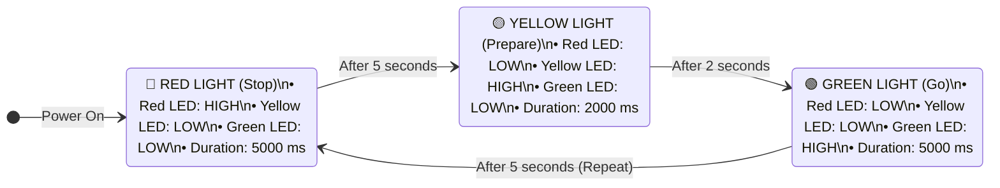

# Traffic Light System

**Teachers Readiness Programme on Robotics and AI — June 2024**  
*Technology Innovation Hub of IIT Delhi (IHFC) & Council for the Indian School Certificate Examinations (CISCE)*  

- **Instructors:**  
  - Dr. Venkat Bokka, IHFC ([venkat@ihfc.co.in](mailto:venkat@ihfc.co.in))  
  - Ms. Mrinmoyee Choudhuri, IHFC ([mrinmoyee@ihfc.co.in](mailto:mrinmoyee@ihfc.co.in))  
- **Source Code Sketch:** [`Traffic Light Code.ino`](./Traffic%20Light%20Code.ino)  
- **Circuit Diagram:** [`Wiring.png`](./Wiring.png)  

---

## Table of Contents
1. [Objective](#1-objective)
2. [Materials Required](#2-materials-required)
3. [Procedure](#3-procedure)
   - [3.1 Connecting the LEDs](#31-connecting-the-leds)
   - [3.2 Program the Arduino](#32-program-the-arduino)
4. [Circuit Assembly & Wiring Diagram](#4-circuit-assembly--wiring-diagram)
5. [Logic of a Traffic Light System](#5-logic-of-a-traffic-light-system)
6. [Arduino Code](#6-arduino-code)
7. [Conclusion](#7-conclusion)

---

## 1. Objective

In this project, we will create a simple traffic light system using an Arduino board. The system will simulate the operation of a traffic light, including red, yellow, and green signals.

---

## 2. Materials Required

| # | Component | Description |
|---|---|---|
| 1 | **Arduino Uno R3** | The microcontroller that will process the sensor data and control the lighting sequence. |
| 2 | **LEDs (3 Colors)** | Light Emitting Diodes that blink/glow; requires 3 different colors: **Red**, **Yellow**, and **Green**. |
| 3 | **$220\,\Omega$ Resistors** | Current-limiting resistors (one for each LED cathode to protect against overcurrent). |
| 4 | **Jumper Wires** | Used to make connections between components (Female-to-Male and Male-to-Male jumpers required). |
| 5 | **Breadboard** | Prototyping board allowing quick, solderless connections between LEDs, resistors, and jumpers. |

---

## 3. Procedure

### 3.1 Connecting the LEDs
- **Anode (+) of the Red LED:** Connect the long leg (anode) of the Red LED to **Digital Pin 4** on the Arduino.
- **Anode (+) of the Yellow LED:** Connect the long leg (anode) of the Yellow LED to **Digital Pin 3** on the Arduino.
- **Anode (+) of the Green LED:** Connect the long leg (anode) of the Green LED to **Digital Pin 2** on the Arduino.
- **Cathode ($-$) of the LEDs:** Connect the short leg (cathode) of each LED to a **$220\,\Omega$ resistor**, then connect the other end of the resistor to the ground (**GND**) on the Arduino board.

### 3.2 Program the Arduino
1. Download and install the Arduino IDE from the official [Arduino Website](https://www.arduino.cc/en/software).
2. Connect your Arduino Uno R3 to your computer using a USB cable.
3. Open the Arduino IDE and select the correct board and port by navigating to:
   - `Tools > Board > Arduino AVR Boards > Arduino Uno`
   - `Tools > Port >` *(Select your Arduino's active COM port)*
4. Open a new sketch by navigating to `File > New`.
5. Write or paste the code into the Arduino IDE editor.
6. Click the **Verify** button ($\checkmark$ icon) to compile the code and check for errors.
7. Once the code compiles successfully, click the **Upload** button ($\rightarrow$ icon) to upload the code to the Arduino board.

---

## 4. Circuit Assembly & Wiring Diagram

The circuit connects three colored LEDs through current-limiting resistors to individual digital output pins and a common ground.

[](./Wiring.png)

> **Image Link:** Click [here to open `Wiring.png`](./Wiring.png) directly in full resolution.

### Wiring Interconnection Table

| Component | Terminal / Leg | Arduino Uno Pin | Function / State Variable |
|---|---|---|---|
| **Red LED** | Long Leg (Anode $+$) | **Digital Pin 4** | Controlled by `redLedPin` |
| | Short Leg (Cathode $-$) | $220\,\Omega$ Resistor $\rightarrow$ **GND** | Current return path |
| **Yellow LED** | Long Leg (Anode $+$) | **Digital Pin 3** | Controlled by `yellowLedPin` |
| | Short Leg (Cathode $-$) | $220\,\Omega$ Resistor $\rightarrow$ **GND** | Current return path |
| **Green LED** | Long Leg (Anode $+$) | **Digital Pin 2** | Controlled by `greenLedPin` |
| | Short Leg (Cathode $-$) | $220\,\Omega$ Resistor $\rightarrow$ **GND** | Current return path |

---

## 5. Logic of a Traffic Light System



- **Red Light (Stop):**
  - Turn on Red LED, turn off Yellow and Green LEDs.
  - Maintain for a fixed duration ($5\,\text{seconds}$).
- **Yellow Light (Prepare to Stop or Start):**
  - Turn on Yellow LED, turn off Red and Green LEDs.
  - Maintain for a fixed duration ($2\,\text{seconds}$).
- **Green Light (Go):**
  - Turn on Green LED, turn off Red and Yellow LEDs.
  - Maintain for a fixed duration ($5\,\text{seconds}$).
- **Transition between States:**
  - After each state, transition to the next state in sequence.
  - Repeat sequence continuously in the `loop()` function to simulate real traffic light operation.

---

## 6. Arduino Code

The standalone sketch file is available at [`Traffic Light Code.ino`](./Traffic%20Light%20Code.ino).

```cpp
// Define LED pins
const int redLedPin = 4;        // Pin connected to the red LED
const int yellowLedPin = 3;     // Pin connected to the yellow LED
const int greenLedPin = 2;      // Pin connected to the green LED

void setup() {
  // Initialize LED pins as outputs
  pinMode(redLedPin, OUTPUT);     // Set red LED pin as output
  pinMode(yellowLedPin, OUTPUT);  // Set yellow LED pin as output
  pinMode(greenLedPin, OUTPUT);   // Set green LED pin as output
}

void loop() {
  // Red light
  digitalWrite(redLedPin, HIGH);     // Turn on red LED
  digitalWrite(yellowLedPin, LOW);    // Turn off yellow LED
  digitalWrite(greenLedPin, LOW);     // Turn off green LED
  delay(5000);                       // Wait for 5 seconds

  // Yellow light
  digitalWrite(redLedPin, LOW);      // Turn off red LED
  digitalWrite(yellowLedPin, HIGH);   // Turn on yellow LED
  digitalWrite(greenLedPin, LOW);     // Turn off green LED
  delay(2000);                       // Wait for 2 seconds

  // Green light
  digitalWrite(redLedPin, LOW);      // Turn off red LED
  digitalWrite(yellowLedPin, LOW);    // Turn off yellow LED
  digitalWrite(greenLedPin, HIGH);    // Turn on green LED
  delay(5000);                       // Wait for 5 seconds
}
```

---

## 7. Conclusion

Congratulations! You have successfully created a traffic light system with Arduino. This project provides a basic understanding of how traffic lights work and how they can be simulated using an Arduino microcontroller. Further enhancements could include pedestrian crossing signals, synchronization with a sensor for real-time traffic control, or adding a button for manual control.
