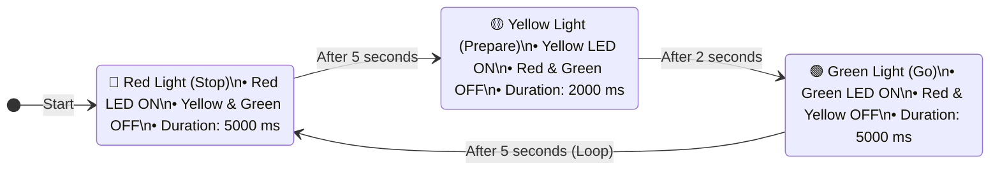

# Traffic Light System

**Teachers Readiness Programme on Robotics and AI — June 2024**  
*Technology Innovation Hub of IIT Delhi (IHFC) & Council for the Indian School Certificate Examinations (CISCE)*  

- **Instructors:**  
  - Dr. Venkat Bokka, IHFC ([venkat@ihfc.co.in](mailto:venkat@ihfc.co.in))  
  - Ms. Mrinmoyee Choudhuri, IHFC ([mrinmoyee@ihfc.co.in](mailto:mrinmoyee@ihfc.co.in))  
- **Source Code Sketch:** [`Arduino Code.ino`](./Arduino%20Code.ino)  
- **Circuit Diagram:** [`Wiring.png`](./Wiring.png)  

---

## Table of Contents
1. [Objective](#1-objective)
2. [Materials Required](#2-materials-required)
3. [Procedure](#3-procedure)
   - [3.1 Connecting the LED](#31-connecting-the-led)
   - [3.2 Program the Arduino](#32-program-the-arduino)
4. [Circuit Assembly & Wiring Diagram](#4-circuit-assembly--wiring-diagram)
5. [Logic of a Traffic Light System](#5-logic-of-a-traffic-light-system)
6. [Arduino Code](#6-arduino-code)
7. [Conclusion](#7-conclusion)

---

## 1. Objective

In this project, we will create a simple traffic light system using an Arduino board. The system will simulate the operation of a traffic light, including red, yellow, and green signals.

---

## 2. Materials Required

- **Arduino Uno R3:** The microcontroller that will process the sensor data.
- **LED:** Light Emitting Diode that will blink, we require 3 different types Red, Yellow, Green.
- **Resistor:** 220 ohm resistor for each LED cathode.
- **Jumper Wires:** Used to make connections between components, Female to Male jumpers are require.

---

## 3. Procedure

### 3.1 Connecting the LED
- **Anode (+) of the Red LED:** Connect the long leg (anode) of the Red LED to digital pin 4.
- **Anode (+) of the Yellow LED:** Connect the long leg (anode) of the Yellow LED to digital pin 3.
- **Anode (+) of the Green LED:** Connect the long leg (anode) of the Green LED to digital pin 2.
- **Cathode (-) of the LED:** Connect the short leg (cathode) of each LED to a 220 ohm resistor, then connect the other end of the resistor to the ground (GND) on the Arduino board.

### 3.2 Program the Arduino
- Download and install the Arduino IDE from the official Arduino website.
- Connect your Arduino Uno R3 to your computer using a USB cable.
- Open the Arduino IDE and select the correct board and port by navigating to `Tools > Board > Arduino Uno` and `Tools > Port > (Select your Arduino's port)`.
- Open a new sketch by navigating to `File > New`.
- Write the following code into the Arduino IDE:
- Click the Verify button / $\checkmark$ icon to compile the code and check for errors.
- Once the code compiles successfully, click the Upload button (right arrow icon) to upload the code to the Arduino board.

---

## 4. Circuit Assembly & Wiring Diagram

The circuit connects three colored LEDs through 220 ohm current-limiting resistors to Arduino digital pins 4, 3, 2, and ground.

[](./Wiring.png)

> **Direct Link:** [Open `Wiring.png` in full resolution](./Wiring.png)

### Wiring Connection Summary

| LED Color | Anode (+) Pin | Cathode (-) Connection | Variable Name |
|---|---|---|---|
| **Red** | Digital Pin 4 | 220 ohm resistor $\rightarrow$ GND | `redLedPin` |
| **Yellow** | Digital Pin 3 | 220 ohm resistor $\rightarrow$ GND | `yellowLedPin` |
| **Green** | Digital Pin 2 | 220 ohm resistor $\rightarrow$ GND | `greenLedPin` |

---

## 5. Logic of a Traffic Light System



- **Red Light (Stop):**
  - Turn on red LED, turn off yellow and green LEDs.
  - Maintain for fixed duration (e.g., 5 seconds).
- **Yellow Light (Prepare to Stop or Start):**
  - Turn on yellow LED, turn off red and green LEDs.
  - Maintain for fixed duration (e.g., 2 seconds).
- **Green Light (Go):**
  - Turn on green LED, turn off red and yellow LEDs.
  - Maintain for fixed duration (e.g., 5 seconds).
- **Transition between States:**
  - After each state, transition to the next state in sequence.
  - Repeat sequence continuously to simulate real traffic light operation.

---

## 6. Arduino Code

The code below matches the original worksheet verbatim. The standalone sketch file is available at [`Arduino Code.ino`](./Arduino%20Code.ino).

```cpp
// Define LED pins
const int redLedPin = 4;        // Pin connected to the red LED
const int yellowLedPin = 3;     // Pin connected to the yellow LED
const int greenLedPin = 2;      // Pin connected to the green LED

void setup() {
  // Initialize LED pins as outputs
  pinMode(redLedPin, OUTPUT);     // Set red LED pin as output
  pinMode(yellowLedPin, OUTPUT);  // Set yellow LED pin as output
  pinMode(greenLedPin, OUTPUT);   // Set green LED pin as output
}

void loop() {
  // Red light
  digitalWrite(redLedPin, HIGH);     // Turn on red LED
  digitalWrite(yellowLedPin, LOW);    // Turn off yellow LED
  digitalWrite(greenLedPin, LOW);     // Turn off green LED
  delay(5000);                       // Wait for 5 seconds

  // Yellow light
  digitalWrite(redLedPin, LOW);      // Turn off red LED
  digitalWrite(yellowLedPin, HIGH);   // Turn on yellow LED
  digitalWrite(greenLedPin, LOW);     // Turn off green LED
  delay(2000);                       // Wait for 2 seconds

  // Green light
  digitalWrite(redLedPin, LOW);      // Turn off red LED
  digitalWrite(yellowLedPin, LOW);    // Turn off yellow LED
  digitalWrite(greenLedPin, HIGH);    // Turn on green LED
  delay(5000);                       // Wait for 5 seconds
}
```

---

## 7. Conclusion

Congratulations! You have successfully created a traffic light system with Arduino. This project provides a basic understanding of how traffic lights work and how they can be simulated using an Arduino microcontroller. Further enhancements could include pedestrian crossing signals, synchronization with a sensor for real-time traffic control, or adding a button for manual control.
